  

   
   
   
  

  

  <picture>
    <source media="(prefers-color-scheme: dark)" srcset="https://raw.githubusercontent.com/Spryzen777/Spryzen777/output/github-contribution-grid-snake-dark.svg">
    
  </picture>

   
  

  

